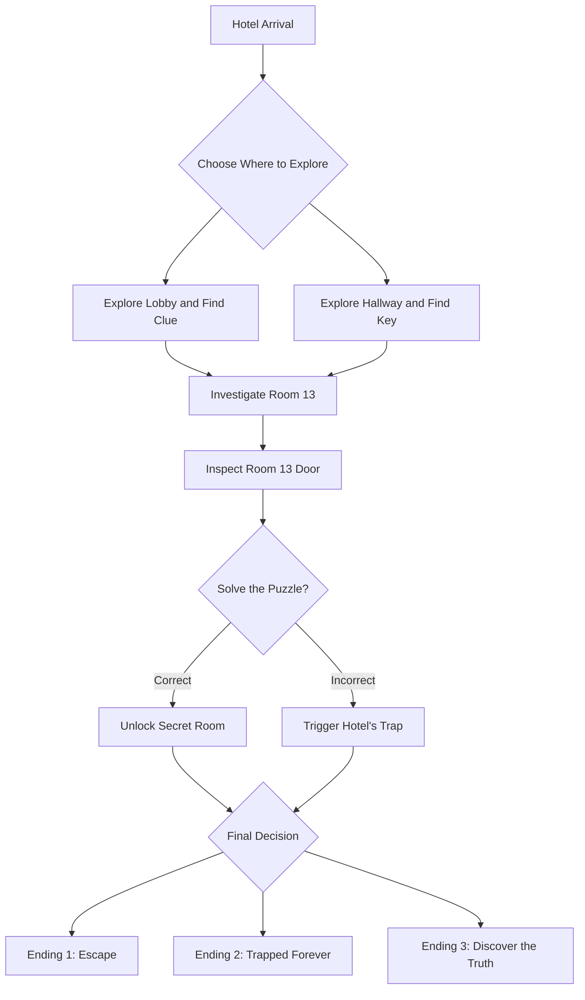

# Final Project: Room 13

## Team Members and Roles

## Team Member — Christian Pizarro
- HTML structure, including the story title, at least three paragraphs with IDs, 2–3 buttons with IDs, and the story image
- Story scene data, branching choices, and at least three distinct endings
- Functions to display story text and navigate between scenes
- Conditional logic and loops
- Two JavaScript classes
- Text-input puzzle and regular expression validation
- Button event listeners
- JSON save/load simulation using JSON.stringify() and JSON.parse()
- setInterval() countdown timer
- README: application overview, gameplay rules, and navigation instructions
- Test story branching and endings

## Team Member — Stefany Koehler
- CSS file and styling for buttons, paragraphs, image sizing, and other visible elements
- Image assets and image-swapping function
- Dynamically created DOM elements using createElement() and appendChild()
- Visible inventory list
- Health, sanity, or score variable and visible UI updates
- One JavaScript class
- Document event listeners
- Keyboard input using keydown
- Image hover interaction using mouseover and mouseout, including tooltip or hint
- Sound effect using new Audio().play()
- Cookie implementation
- setTimeout() timed story event
- README: team member names and responsibilities

## Shared Responsibilities
- Choose the story theme and develop the human-written narrative
- Sketch the branching story structure before coding
- Create the shared GitHub repository and use branches for each team member
- Communicate through Teams, Teams chat, or email
- Practice peer programming through pseudocode or working together
- Review each other's code using GitHub pull requests or issues
- Implement and test try...catch error handling
- Integrate and test all three JavaScript classes
- Test the complete application and verify that all required features work
- Publish the GitHub Pages site
- Submit the clickable GitHub repository link and GitHub Pages link

## Application Overview

**Room 13** is an interactive, browser-based mystery and horror story in which the player explores a mysterious hotel and attempts to uncover the secrets behind Room 13. Through exploration, decisions, clues, and interactive puzzles, the player will determine how the story unfolds and which ending they receive.

### Gameplay Features
- **Branching story:** Player decisions influence the scenes they encounter and the ending they receive.
- **Exploration:** Players interact with hotel locations and objects to discover clues and items.
- **Inventory:** Collected items are displayed in a visible inventory.
- **Puzzle:** Players must discover clues and enter a correct answer to unlock a progression point.
- **Player stat:** A tracked stat influences certain decisions or story outcomes.
- **Timed event:** Certain events may require the player to act before a countdown expires.
- **Multiple endings:** The story includes at least three distinct endings determined by player choices and discovered clues.
- **Interactive elements:** Buttons, keyboard interactions, image changes, sound effects, and story events create an interactive experience.

### Navigation and Rules
- Players advance through the story by selecting buttons and interacting with objects.
- Certain choices may unlock or restrict future scenes.
- Items and clues may be required to unlock puzzles or specific paths.
- The player can enter answers into designated text fields to solve puzzles.
- Player decisions and progress determine which ending is reached.
- The story is played in a web browser.

## Story Flowchart

The flowchart below represents the planned branching structure of Room 13, including the major scenes, player choices, puzzles, and endings.

## Project Technologies

- HTML
- CSS
- JavaScript
- Git and GitHub
- GitHub Pages

## Repository and Deployment

The project will be developed collaboratively using Git branches and pull requests. Each team member will contribute code and content, review their partner's work, and test the completed application.

The finished project will be published using GitHub Pages.
